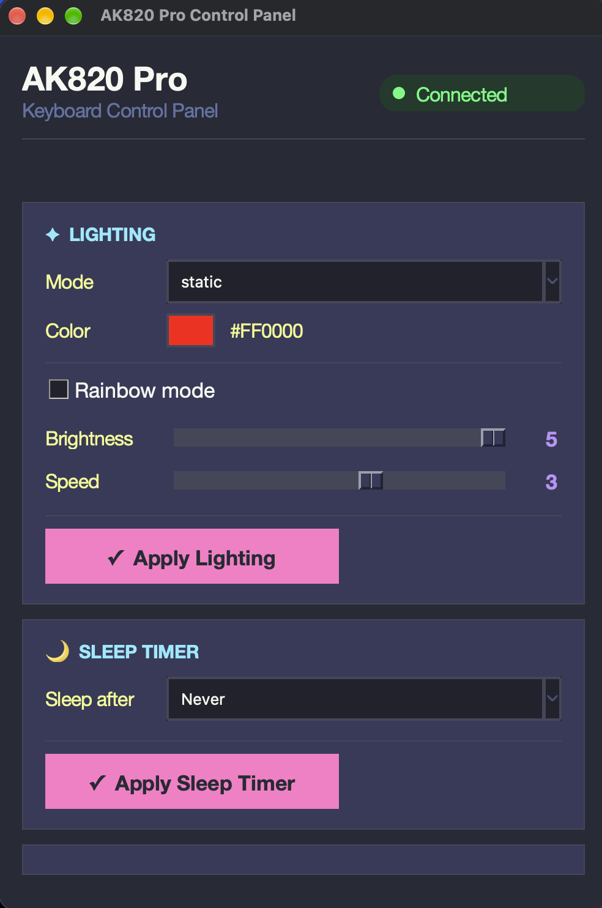
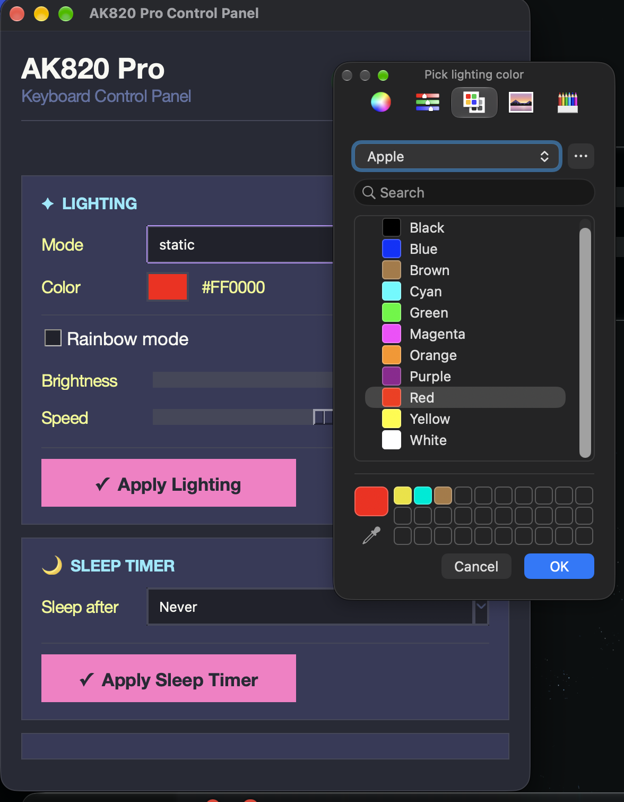

# AK820 control (Python)

Control software for the Ajazz AK820 Pro keyboard. It includes a graphical app and a command-line tool for keyboard lighting, the sleep timer, the built-in clock, and the LCD screen.

## Screenshots





## Requirements

- Python 3.9 or newer
- Tkinter, for the graphical app (often included with Python; on macOS install `python-tk` with Homebrew)
- `libusb` (needed by PyUSB to communicate with the keyboard)
- Python packages listed in [`requirements.txt`](requirements.txt): PyUSB and Pillow

The GUI and CLI do not need Pillow for basic controls. Pillow is needed for LCD commands; it is included in `requirements.txt` so all project features are installed together.

## Install

Open Terminal and change into the folder containing this README. Create a virtual environment and install the project and its dependencies:

```bash
python3 -m venv .venv
```

Activate it:

```bash
# macOS / Linux
source .venv/bin/activate
```

Install the Python dependencies and the `ak820` command-line package:

```bash
python -m pip install --upgrade pip
python -m pip install -r requirements.txt
python -m pip install -e .
```

Use this virtual environment whenever you run the app. To activate it again in a new Terminal window, run `source .venv/bin/activate` from the project folder.

### macOS setup

Install Homebrew if it is not already installed, then install the USB and Tk libraries:

```bash
brew install libusb python-tk
```

If `python3` is not available, install Homebrew Python with `brew install python` and then repeat the virtual environment steps above. macOS USB access may require running the app with `sudo`; the command below uses the virtual environment's Python so it can still find the installed packages.

### Linux setup

On Debian or Ubuntu, install the system USB and Tk libraries before creating the virtual environment:

```bash
sudo apt update
sudo apt install libusb-1.0-0 python3-tk python3-venv
```

To run the app without `sudo`, install the udev rule as described in [USB permissions](#usb-permissions-linux-only). Otherwise, run it with `sudo` using the virtual environment's Python.

## Run the graphical app

With the virtual environment activated, run:

```bash
python -m ak820.gui
```

Or use the installed shortcut:

```bash
ak820-gui
```

If keyboard access is denied, use the platform-specific USB permission instructions above. For macOS, try:

```bash
sudo .venv/bin/python -m ak820.gui
```

For Linux without the udev rule, use:

```bash
sudo .venv/bin/python -m ak820.gui
```

## Run the command-line tool

With the virtual environment activated:

```bash
ak820-ctl list-modes
ak820-ctl probe
ak820-ctl light static --color ff0000 --brightness 5 --speed 3
ak820-ctl sleep never
ak820-ctl sync-time
```

Available lighting modes: `off`, `static`, `single-on`, `single-off`, `glittering`, `falling`, `colourful`, `breath`, `spectrum`, `outward`, `scrolling`, `rolling`, `rotating`, `explode`, `launch`, `ripples`, `flowing`, `pulsating`, `tilt`, and `shuttle`.

Options for `light`:

- `--color` / `-c`: hex RGB color (default `ff0000`)
- `--rainbow` / `-r`: use rainbow colors
- `--brightness` / `-b`: 0 to 5 (default 5)
- `--speed` / `-s`: 0 to 5 (default 3)
- `--direction` / `-d`: `left`, `right`, `up`, or `down`, depending on the selected mode

Other commands:

```bash
ak820-ctl sleep never       # never | 1m | 5m | 30m
ak820-ctl sync-time
ak820-ctl lcd --interval 5 --max-interval 60
ak820-ctl lcd-test red      # red | green | blue | white | black | diag | hex
ak820-ctl stats
```

## USB permissions (Linux only)

To access the keyboard as your normal user, install the included udev rule:

```bash
sudo cp 99-ak820.rules /etc/udev/rules.d/
sudo udevadm control --reload-rules
sudo udevadm trigger
```

Unplug and reconnect the keyboard after installing the rule. Without it, run the GUI or CLI with `sudo`.

## Debugging

- Set `AK820_DEBUG=1` to print every USB packet sent to the keyboard.
- Set `AK820_IFACE=<n>` to choose a USB interface (default: `3`, the vendor control interface).
- On macOS, USB access can fail if macOS holds the keyboard's HID interface. macOS support is untested.

## Project layout

| File | Purpose |
| --- | --- |
| `ak820/protocol.py` | Packet builders, enums, RGB565 encoding |
| `ak820/usb_device.py` | libusb backend used by the CLI and GUI |
| `ak820/hidraw.py` | Linux `/dev/hidraw*` ioctl backend |
| `ak820/device.py` | `hidapi` backend |
| `ak820/lcd.py` | LCD framebuffer renderer (Pillow) |
| `ak820/stats.py` | CPU/GPU temperature and memory stats |
| `ak820/cli.py` | `ak820-ctl` command |
| `ak820/gui.py` | Tkinter graphical app |

## Credits

MIT license, like the original project. Protocol work by the [TaxMachine C++ reference](https://github.com/TaxMachine/ajazz-keyboard-software-linux) and [KyleBoyer/TFTTimeSync-node](https://github.com/KyleBoyer/TFTTimeSync-node) (clock sync), as credited in the original repository.
